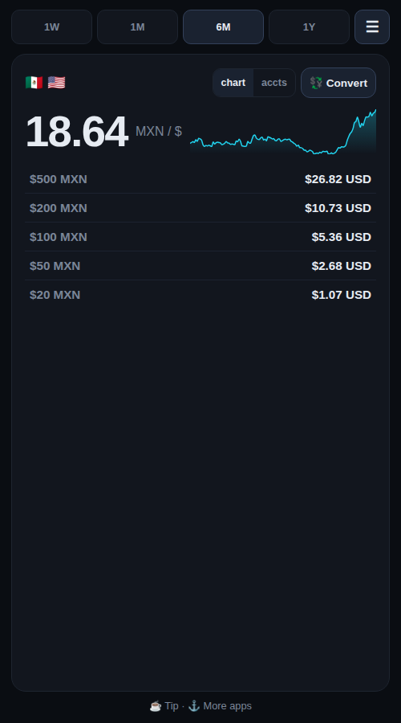
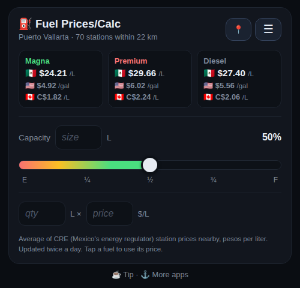
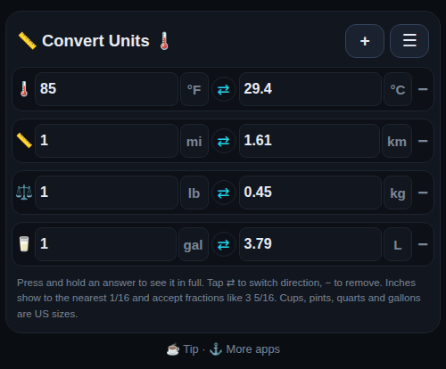

# Cambio

**Everyday tools for Americans and Canadians in Mexico: live peso rates, local fuel prices and a unit converter.**

🔗 **Live:** [cambio.jasonhite.com](https://cambio.jasonhite.com)

Works on any phone browser and installs to the home screen like an app. No ads, no sign-up, no app store.

  
  
  

## Features

| Screen | What it does |
|---|---|
| 🇺🇸 USD ↔ MXN 🇲🇽 · 🇨🇦 CAD ↔ MXN · USD ↔ CAD | Live rate, 1W–1Y chart, peso bill values, cash converter, saved account balances |
| ⛽ Fuel Prices/Calc | Average Magna / Premium / Diesel prices from nearby stations (or your location), shown in MXN/L, US$/gal and C$/L, plus a tank-fill cost calculator |
| 📏 Convert Units 🌡️ | Length (inches in fractions), temperature, speed (incl. knots), volume, weight, area, with one-tap direction switch |

## How it works

- **Static site:** plain HTML/CSS/JavaScript on GitHub Pages, no framework and no build step. Each screen is one file and has its own home-screen install manifest.
- **Scheduled data jobs:** GitHub Actions run Python scripts that refresh the data and commit it back to the repo. For example, fuel prices update twice a day from CRE (Mexico's energy regulator) station price data. That's why the commit history has frequent automated data commits.
- **Exchange rates:** a live rate feed refreshed every 15 minutes, with ECB history (Frankfurter) and a fallback API.
- **Privacy:** settings and balances are stored only in the user's browser.

Built by [Jason Hite](https://www.jasonhite.com) with [Claude Code](https://claude.com/claude-code) as an AI pair programmer.

## Licensing & white-label

Copyright © 2026 Jason Hite. All rights reserved. See [LICENSE](LICENSE).

Want a version branded for your business (your logo, links and ads)? Get in touch via [jasonhite.com](https://www.jasonhite.com).
